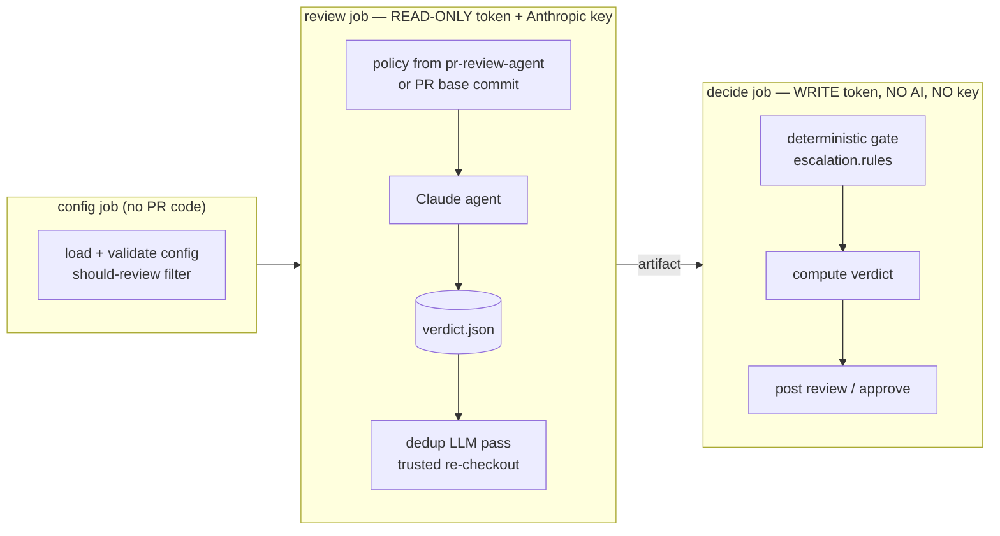

# Security model

pr-review-agent runs an LLM agent over untrusted input (the PR) and can approve PRs.
The design keeps the AI away from privileges and keeps the rules away from the PR.

## Guarantees

1. **The PR cannot change the rules it is judged by.** The workflow, scripts, prompt
   and default rubric come from pr-review-agent, checked out at `job.workflow_sha`. The
   team config is read once, in the `config` job, from the reviewed repository's
   **default branch**. Skills or a rubric kept in the reviewed repository are read from
   the PR's **base** commit. Editing the config, skills or rubric escalates
   automatically.
2. **The agent cannot act.** The agent job has a read-only `GITHUB_TOKEN` and no
   GitHub PAT, so it cannot approve, comment or push. Its only intended output is
   `ai-review/verdict.json`, which `decide` treats as untrusted input.
3. **The verdict can only be downgraded.** `decide` runs no AI and holds no Anthropic
   key. It re-derives the escalation paths from the changed-file list (including the old
   path of renamed files) and turns any
   match into NEEDS_HUMAN, whatever the agent wrote. A confidence below 0.85, malformed
   values or a gate error also result in NEEDS_HUMAN.
4. **Post-agent scripts are not taken from files the agent could edit.** pr-review-agent
   is checked out only once, in the `config` job, which runs no AI and no PR code. That
   job is also the only place the optional checkout token (`agent_repo_token_vault_secret`)
   is imported. It uploads the scripts, prompts and the resolved config as an immutable artifact,
   and the `review` and `decide` jobs download that artifact. The agent job never holds
   a GitHub token beyond its read-only `GITHUB_TOKEN`. Steps after the agent that hold
   the Anthropic key (dedup, transcript masking) run scripts from a fresh download of
   that artifact. They never run from the PR checkout or the first
   copy of pr-review-agent, which the agent could have changed with `Write`. Their
   outputs are still treated as untrusted (see *Runner compromise* below).
5. **Agent text cannot ping or spoof.** `@` mentions in agent text are broken with a
   zero-width space. Counterfeit `<!--` calibration markers are neutralised. The
   trusted marker is always the last line.
6. **Forks, `pull_request_target` and drafts are not reviewed by default.** Fork PRs get
   no Vault secrets. `pull_request_target` is refused because the review job checks out
   PR code while holding the key. Drafts are reviewed only with the opt-in label (or
   `review_drafts: true`), and drafts are never approved.
7. **Approval needs green required checks, a non-draft PR, and the reviewed commit.**
   In live mode, the approve step re-reads the draft state and waits for **required**
   checks, which the PR author cannot redefine. It approves only if the PR head is
   still the commit the agent reviewed, both before and after that wait, and it
   anchors the approval to that commit (`commit_id`). Runs for the same PR also cancel
   each other (workflow-level `concurrency`). An approval from `github-actions[bot]` does not
   count toward required-reviewer branch protection.

## Residual risks

- **Prompt injection that changes the agent's opinion** is possible. It is contained by
  guarantees 2 and 3: the worst case is a wrong AUTO_APPROVE on a path that is not an
  escalation path, while required checks pass. That approval does not satisfy
  required-reviewer protection.
- **Secrets in the transcript.** The masked transcript is uploaded as an artifact.
  Masking removes known secret values and common token shapes. It does not stop a
  hijacked agent from encoding a secret it read, for example as base64.
- **Runner compromise.** `Bash(gh:*)` / `Bash(git:*)` keep the agent on task, but they
  are **not a sandbox**: git and gh aliases can run arbitrary commands, and hosted
  runners give passwordless sudo. A successfully injected agent should be treated as
  owning the review VM. That exposes what the review job already holds: the Anthropic
  key, which the agent process has anyway, and a read-only `GITHUB_TOKEN`. No broader
  token is present. It can also
  forge `verdict.json` and `dedup.json`. It cannot reach the write token or change the
  gate, because `decide` runs on a fresh VM, uses only pr-review-agent code, and
  re-derives escalation without the LLM. If the Anthropic key's blast radius matters
  for your team, use a key that is dedicated to this workflow and rate-limited.
  Removing Bash in favour of pre-fetched PR context is a possible future hardening.

## Before enabling live mode

- Calibrate in shadow mode. Each review ends with a
  `<!-- ai-review verdict=… escalation_type=… confidence=… shadow=… -->` marker, so
  you can backtest which PRs would have been auto-approved.
- File the InfoSec exception for automated approvals in your repository.
- Make sure branch protection still requires a human or CODEOWNER review where needed.
  The bot's approval is not meant to replace it.
