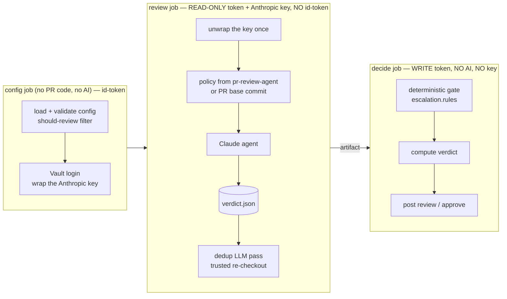

# Security model

pr-review-agent runs an LLM agent over untrusted input (the PR) and can approve PRs.
The design keeps the AI away from privileges and keeps the rules away from the PR.

## Guarantees

1. **The PR cannot change the rules it is judged by.** The workflow, scripts, prompt
   and default rubric come from pr-review-agent, checked out at `job.workflow_sha`. The
   team config is read once, in the `config` job, from the reviewed repository's
   **default branch**. Skills or a rubric kept in the reviewed repository are read from
   the PR's **base** commit. Editing the config, skills or rubric escalates
   automatically.
2. **The agent cannot act.** The agent job has a read-only `GITHUB_TOKEN` and no
   GitHub PAT, so it cannot approve, comment or push. Its only intended output is
   `ai-review/verdict.json`, which `decide` treats as untrusted input.
3. **The verdict can only be downgraded.** `decide` runs no AI and holds no Anthropic
   key. It re-derives the escalation paths from the changed-file list (including the old
   path of renamed files) and turns any
   match into NEEDS_HUMAN, whatever the agent wrote. A confidence below 0.85, malformed
   values or a gate error also result in NEEDS_HUMAN.
4. **Post-agent scripts are not taken from files the agent could edit.** pr-review-agent
   is checked out only once, in the `config` job, which runs no AI and no PR code. That
   job is also the only place the optional checkout token (`agent_repo_token_vault_secret`)
   is imported. It uploads the scripts, prompts and the resolved config as an immutable artifact,
   and the `review` and `decide` jobs download that artifact. The agent job never holds
   a GitHub token beyond its read-only `GITHUB_TOKEN`. Steps after the agent that hold
   the Anthropic key (dedup, transcript masking) run scripts from a fresh download of
   that artifact. They never run from the PR checkout or the first
   copy of pr-review-agent, which the agent could have changed if it escaped its tool
   rules (guarantee 9). Their
   outputs are still treated as untrusted (see *Runner compromise* below).
5. **Agent text cannot ping or spoof.** `@` mentions in agent text are broken with a
   zero-width space. Counterfeit `<!--` calibration markers are neutralised. The
   trusted marker is always the last line.
6. **Forks, `pull_request_target` and drafts are not reviewed by default.** Fork PRs get
   no Vault secrets. `pull_request_target` is refused because the review job checks out
   PR code while holding the key. Drafts are reviewed only with the opt-in label (or
   `review_drafts: true`), and drafts are never approved.
7. **Approval needs green required checks, a non-draft PR, and the reviewed commit.**
   In live mode, the approve step re-reads the draft state and waits for **required**
   checks, which the PR author cannot redefine. It approves only if the PR head is
   still the commit the agent reviewed, both before and after that wait, and it
   anchors the approval to that commit (`commit_id`). Runs for the same PR also cancel
   each other (workflow-level `concurrency`). An approval from `github-actions[bot]` does not
   count toward required-reviewer branch protection.
8. **The agent's job cannot reach Vault.** Only the `config` job logs in to Vault (AppRole
   or JWT), and only it has `id-token: write`. A team's Vault role can usually read far
   more than the Anthropic key. So `config` wraps only the key in a single-use Vault
   response-wrapping token with a TTL of 5 minutes. This follows Infrastructure's
   [Vault secrets in agentic workflows](https://docs.int.camunda.com/docs/vault/vault-secrets-in-agentic-workflows)
   policy and uses its shared `vault-wrapped-secrets` action (`wrap` for JWT,
   `vault-wrap-key.sh` for AppRole until AppRole is turned off). The `review` job
   unwraps it at the start, before any checkout and before the agent starts (`vault-wrapped-secrets/unwrap`,
   which also rejects a token not created by `sys/wrapping/wrap`). After that, the job holds
   no Vault credential: the wrapping token is used up, and without `id-token` no step
   can request a GitHub OIDC token, which would otherwise log in with the team's role
   or reach other systems that trust the repository's OIDC tokens. If something else
   unwraps the token first, the review fails instead of running. Before the unwrap, a
   step fails the `review` job if it has OIDC access, so a later edit that grants
   `id-token: write` there cannot slip through.
9. **The agent has only the tools the prompt needs.** Bash is limited to `gh pr view`
   and `gh pr diff`. The agent has no git command, so git aliases and git flags that
   write files (`--output`), read files outside the repository (`--no-index`) or run
   commands (`--ext-diff`, `--textconv`) are not available. Neither are `gh alias set
   --shell` and `gh api --hostname`. As an extra guard, git ignores system and user
   config in the agent step. The agent can write files only below `ai-review/`, and `Read` cannot read
   `/proc` (where the process environment, and so the key, is). Prefix rules are not a
   sandbox, so guarantees 2–4 do not depend on them.
10. **Agent output is masked before it leaves the review job.** The transcript,
    `verdict.json` and `dedup.json` are masked (literal secret values and common token
    shapes) in the review job, the only job that holds the key. `decide` posts text from
    `verdict.json` and `dedup.json` on the PR. If masking fails, or if either file is a
    symlink, a directory or another non-regular file, or is not exactly one JSON value,
    nothing is uploaded. Masking works on the decoded JSON, so `\uXXXX` escapes do not
    hide a secret. The review
    job starts with an empty `ai-review/` directory, so the PR cannot place entries
    there.
11. **On public repositories, the review job can reach only an allowlist of hosts.**
    `step-security/harden-runner` blocks all other egress from the agent step onwards
    and disables `sudo`, so the firewall cannot be removed. The review job runs on
    `ubuntu-latest`, because harden-runner does not work on `ubuntu-slim` or self-hosted
    runners. Private repositories are not filtered: harden-runner needs a paid plan there.

## Public repositories

On a public repository anyone can comment on a PR, and the agent reads PR content and
comments. Assume that a prompt injection reaches the agent. Fork PRs are skipped, which
limits who can open a reviewed PR, but not who can write text that the agent reads.
Shadow mode does not reduce this risk: the leak needs no approval.

The goal of an injected agent is the Anthropic key. Guarantee 9 removes the known ways
to run commands or to write files outside `ai-review/`. Guarantee 11 stops the key from
being sent to an outside host if the agent still finds a way to run code. Guarantee 10
stops a literal key in the agent's text from being posted on the PR. Guarantee 8 keeps
the team's Vault role and OIDC access out of reach in any case.

## Residual risks

- **Prompt injection that changes the agent's opinion** is possible. It is contained by
  guarantees 2 and 3: the worst case is a wrong AUTO_APPROVE on a path that is not an
  escalation path, while required checks pass. That approval does not satisfy
  required-reviewer protection.
- **Secrets in the transcript.** The masked transcript is uploaded as an artifact.
  Masking removes known secret values and common token shapes. It does not stop a
  hijacked agent from encoding a secret it read, for example as base64.
- **Encoded secrets in posted text.** Masking finds literal values and known token
  shapes. It does **not** find a secret that a hijacked agent encodes (base64, hex, …)
  into `verdict.json`, which `decide` then posts on the PR — publicly, on a public
  repository. The egress allowlist covers outbound traffic, not text posted on the PR.
  Mitigation: one Anthropic key per team, with a spend cap, that the team can rotate.
- **The egress allowlist includes GitHub and Azure blob storage** (`github.com`,
  `api.github.com`, `*.blob.core.windows.net`), because the job needs them. An agent
  that runs code could send data there with credentials of its own. Guarantee 9 is what
  stops the agent from running code.
- **Runner compromise.** The tool rules (guarantee 9) are **not a sandbox**: a bug in
  Claude Code's rule matching or a new `gh` feature could still let the agent run
  commands, and hosted runners give passwordless sudo (on private repositories). A
  successfully injected agent should be treated as
  owning the review VM. That exposes what the review job already holds: the Anthropic
  key, which the agent process has anyway, and a read-only `GITHUB_TOKEN`. No broader
  token is present, and no Vault credential or OIDC access (guarantee 8). It can also
  forge `verdict.json` and `dedup.json`. It cannot reach the write token or change the
  gate, because `decide` runs on a fresh VM, uses only pr-review-agent code, and
  re-derives escalation without the LLM. If the Anthropic key's blast radius matters
  for your team, use a key that is dedicated to this workflow and rate-limited.
  Removing Bash in favour of pre-fetched PR context is a possible future hardening.

## Before enabling live mode

- Calibrate in shadow mode. Each review ends with a
  `<!-- ai-review verdict=… escalation_type=… confidence=… shadow=… -->` marker, so
  you can backtest which PRs would have been auto-approved.
- File the InfoSec exception for automated approvals in your repository.
- Make sure branch protection still requires a human or CODEOWNER review where needed.
  The bot's approval is not meant to replace it.
